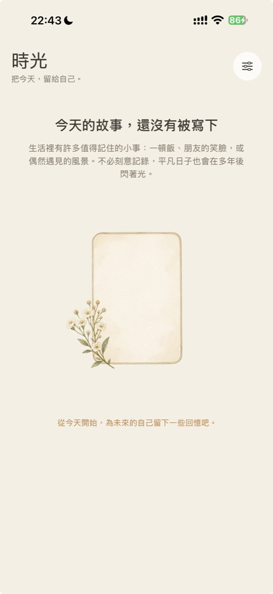
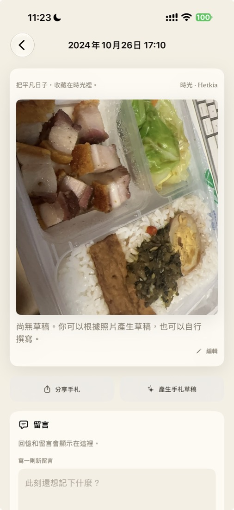
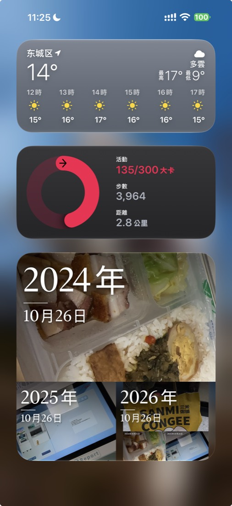
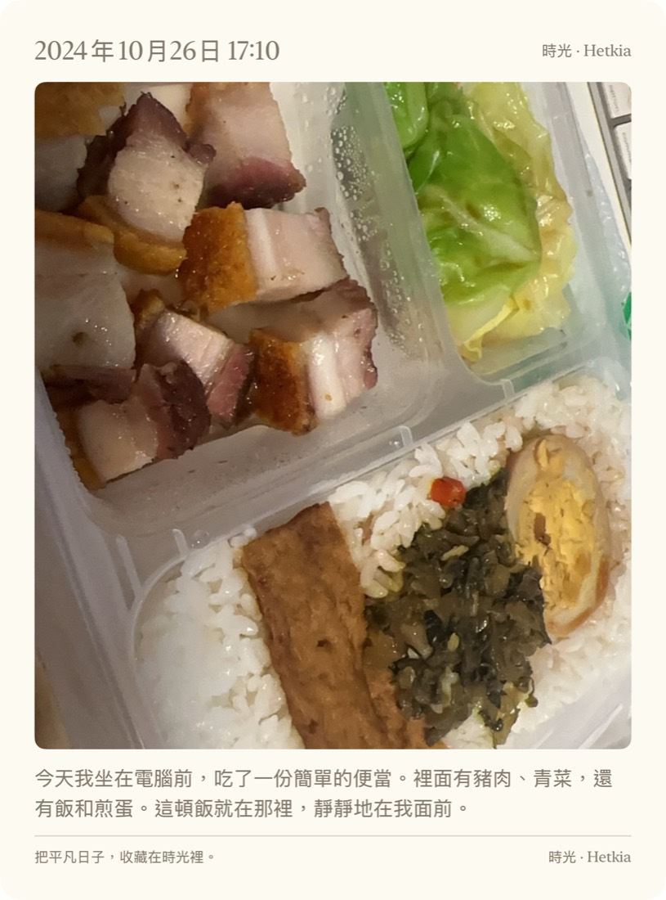
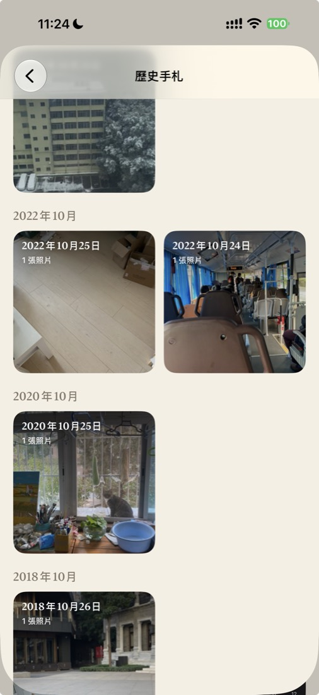
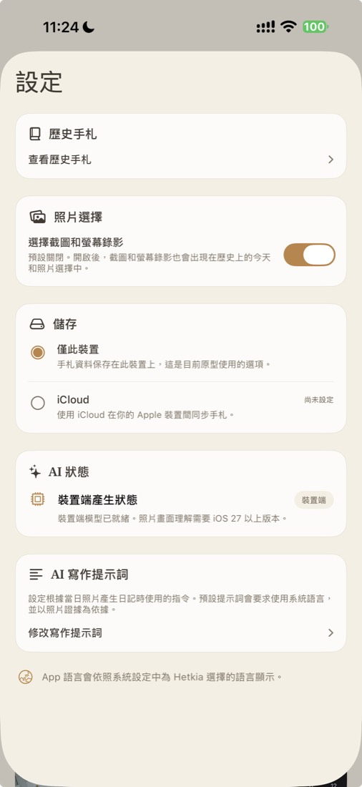

# Hetkia

English | [简体中文](README_CN.MD)

This project is licensed under the [MIT License](LICENSE).

The screenshots below are a bit out of date—I’ll refresh them when I get around to it. They predate Hugo integration and the image CDN.

### Why I built this

When messaging apps started leaning harder into personal data—for training models and other uses—long-time users who rarely post publicly felt the squeeze. I’ve run a personal site on Hexo and Hugo for years, so I extended Hugo with short “moment” posts for quick venting.

In practice, sharing falls into a few buckets:

1. **Moments** — a line or paragraph, usually without images  
2. **Essays** — journal-style text, sometimes with photos  
3. **Experience** — knowledge you want to keep on the site long term  
4. **Fiction** — a personal hobby category  

Publishing habits differ too:

- Moments should be fast from the phone—no formatting ceremony.  
- Essays are similar: optional photos, mostly phone, sometimes desktop.  
- Experience posts and fiction are still desktop-first.  

Both Hexo and Hugo expect a `git push`. That’s awkward on a phone, but a small dedicated app makes the workflow much simpler.

I always liked a “On This Day” style feature in another app: it groups photos taken on the same calendar day across years. I wanted that for my own library. Eventually I revoked broad photo access there and only exposed a few albums, so that feature was gone for me.

**Hetkia** is the app I wrote to fill that gap.

Hetkia is an iOS photo-memory app focused on **“On This Day.”** The home screen shows photos from the same month and day in past years, using the device’s local calendar. Browsing only reads PhotoKit and loads images from the system when needed. Journals, photo links, and JPEG previews are saved on device only when you generate a journal, edit and save text, or post a message.

### Privacy layers

- **Most private:** full journals stay on your iPhone. I don’t sync them via iCloud; iPad is mostly layout adaptation (e.g. two columns on the home screen).  
- **Sharing:** pick a few photos from a day, compose a nice collage with your words, export an image card, and send it to someone.  
- **Publishing:** push an essay (with optional images) or a text-only moment to your Hugo repo via GitHub; CI can deploy the site. In this project, essays map to Hugo “essays”; you can point paths at your own layout.  
- **No images:** publish a plain-text moment—a quick rant without extra steps.  

GitHub Pages and Cloudflare R2 settings are built in. If you use the same stack, you can plug in your values; other hosts or CDNs need code changes. For anything else, a good LLM and the docs usually get you there.

## Features

- The first launch explains and requests full access to the photo library. After access is granted, the app scans today and matching dates from previous years, shows progress, and opens the home screen automatically.
- The home screen shows only “On This Day.” Photos fill each card, with the date overlaid in white. All eligible photos are shown in a dynamic-height collage built on a one-third grid; layouts avoid empty cells, including for even photo counts.
- Journal details support photo viewing, full-screen paging, place maps, share images, journal editing, on-device AI drafts, messages, and optional **remote publishing** (Hugo essays with optional images, or text-only moments). Essays can use **now** or **photo capture date** as the published `date`. Publishing does not auto-save the journal locally. GitHub tokens and R2 keys stay in the device Keychain; repo paths and CDN domain are configured in Settings → Publish service. Success closes the publish sheet; connection tests show results under each settings card.
- Journal text and messages are stored separately. An AI draft appears above the message board; applying it asks for confirmation if journal text already exists. Browsing alone does not create a saved journal or JPEG preview.
- The root screen uses a floating bar to switch between **Home** (On This Day) and **History** (locally saved journals). On History, **Month / Year / All** browse levels: all entries, a year grid, a month grid for a year (year+month on each card), then journals for one month. The bar handles navigation between levels—no in-list back control or swipe-back. Tapping **History** again resets to **All**. The bar hides on journal detail.
- History reads only local SwiftData; card images are full-bleed with dates or year-month and entry counts in white.
- The large Home Screen widget creates a full-bleed collage from the first image of each matching-date group. It shows up to nine years in a one-third-grid collage and prioritizes photos with GPS coordinates. Two images use a full-size background image with a small inset image. The title and brand name overlay the image. StandBy and small widgets use an image-only collage. Each image can deep-link to its corresponding journal.
- Personal messages can be edited or deleted. If the last message is deleted and the journal has no body text or AI draft, the empty journal and its linked photo previews are deleted as well.
- The AI prompt can be reviewed and customized in Settings. The default asks for a 2–5 sentence entry grounded in the photos and metadata, written in the current system language without specific dates. Prompts are limited to 1,500 user-perceived characters; Save displays an alert and is blocked above the limit.
- Photos, Live Photos, and videos can appear. Screenshots and screen recordings are excluded by default and can be enabled in Settings; when enabled, regular camera media is prioritized. Hidden items are omitted. Items in “Recently Deleted” are not included in standard PhotoKit library fetches.
- Supported languages: Simplified Chinese, Traditional Chinese, English, Spanish, and Thai.

Text over photos uses white with a subtle dark gradient for contrast. WidgetKit may adapt widget rendering to the display context, but it does not automatically choose text color based on each image’s brightness. Journal details and shared journal images use the same one-third-grid photo layout; detail card height adapts to the collage, while the share card retains its date and time.

## Platforms and AI

- iPhone and iPad only. The minimum deployment target is **iOS/iPadOS 18**; macOS and Mac Catalyst are not supported.
- Non-AI features—including photo access, system thumbnails, local journal storage, maps, sharing, and WidgetKit—are available on iOS 18.
- Journal text generation with Apple Foundation Models requires iOS 26 or later, a supported device, and a ready model. The app checks the OS version and model availability when the user requests generation. Image understanding input requires iOS 27 or later.

Background refresh is scheduled on a best-effort basis by the system and is not guaranteed to run exactly at midnight. When the app is active, it refreshes by querying PhotoKit.

The home screen first displays the local photo-index cache for the current date. When the cache is valid, a regular launch queries only the current year’s photos for today. Pulling down on the home screen forces a full scan across all years. The first scan and the first launch after a new day also scan all years.

On a warm launch, the cached cards stay on screen while the current-year query runs. The home view only publishes the result when its dates or photo identifiers changed, avoiding a full-card redraw for an unchanged result. An in-process scan coordinator coalesces concurrent requests with the same date, time zone, filter settings, and scope. An in-flight full scan can satisfy a narrower current-year check; a narrow check cannot replace a requested full scan. Results carry generations so stale dates or older batches cannot overwrite a newer index. The progress indicator is reserved for the initial full scan and a user-requested full refresh.

A full scan still queries PhotoKit by date for media from 1900 through the current year, even when saved journals exist. A saved journal does not prove that no new photos were added for that anniversary, and the complete media set needed for journal actions is distinct from the home screen’s prioritized display set. Journal persistence keeps its existing triggers and write behavior; a home-cache hit does not skip photo associations or JPEG preview generation required by an explicit user action.

The main app and Widget Extension run in separate processes. The app writes a lightweight widget index through the App Group, and the widget restores assets by identifier. If the snapshot is stale or an asset is unavailable, the widget falls back to its own PhotoKit query. The app’s scan coordinator is not shared across processes, avoiding concurrent SwiftData writes from the widget.

## Screenshots

| Empty home state | Journal details |
| --- | --- |
|  |  |

| Home Screen widget | Shared journal image |
| --- | --- |
|  |  |

| Saved Journals | Settings |
| --- | --- |
|  |  |

More reference screens, including widget collage formatting and detail actions, are in [`screenshot/`](screenshot/).

## Build

```sh
xcodebuild -project Hetkia.xcodeproj -scheme Hetkia -configuration Debug -destination 'generic/platform=iOS Simulator' CODE_SIGNING_ALLOWED=NO build
```

See the [product requirements](docs/PRODUCT_REQUIREMENTS.md) for the complete product behavior and the [development guide](docs/DEVELOPMENT.md) for implementation details and verification notes.

The repository does not contain API keys or deploy secrets. Configure GitHub and R2 credentials only on the device.

## Repository layout

```text
Hetkia-Starter/
├── Hetkia.xcodeproj/            # App and WidgetKit extension targets
├── Hetkia/                      # SwiftUI app, onboarding, details, PhotoKit, settings, publishing, and localization
├── HetkiaWidget/                # On This Day WidgetKit extension
├── Design/                      # Design source files
├── screenshot/                  # Compressed reference screenshots named by content
└── docs/                        # Product requirements and development guide
```

The README files provide an English and Simplified Chinese overview; detailed product behavior and implementation guidance are maintained in the linked documents. Reference screenshots are organized in `screenshot/` by home screen, details, settings, saved journals, widgets, and share images.
