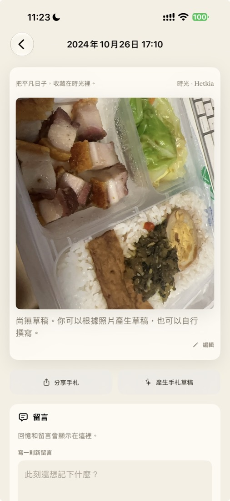
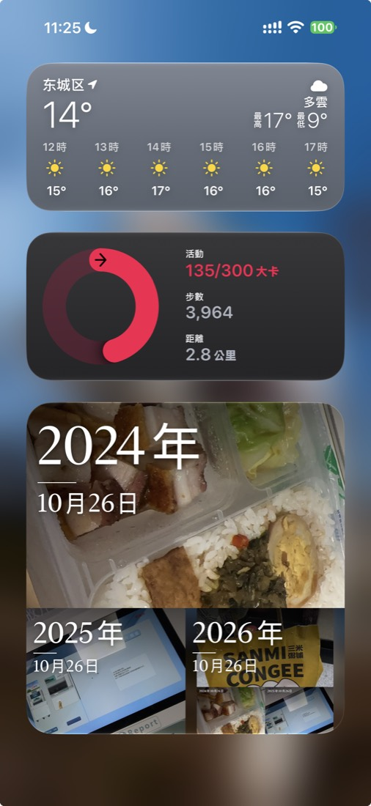
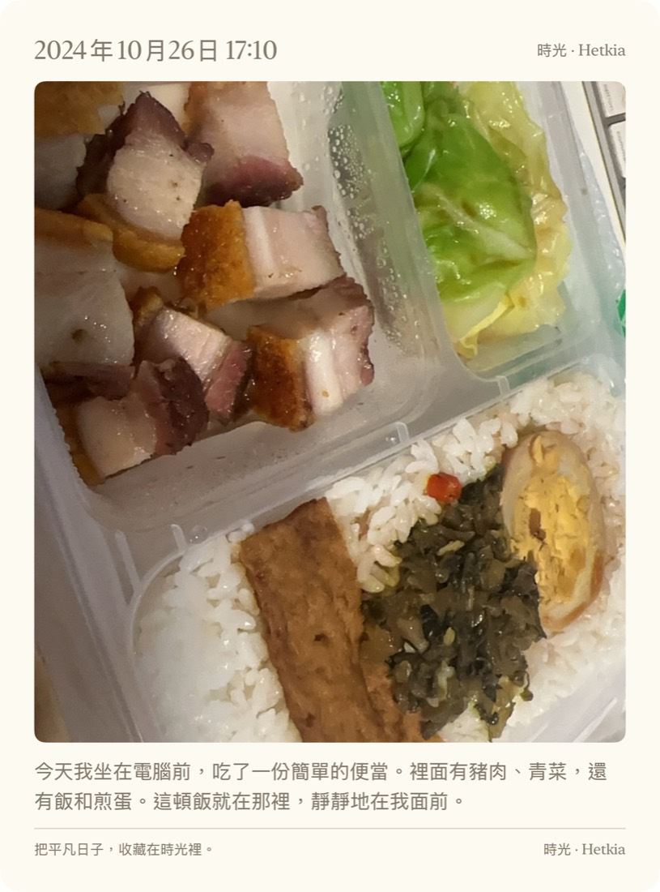
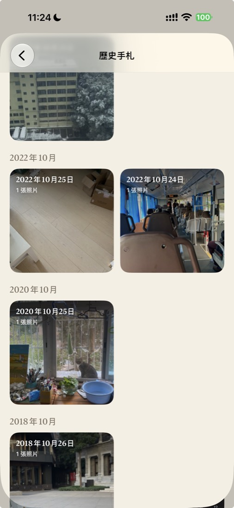
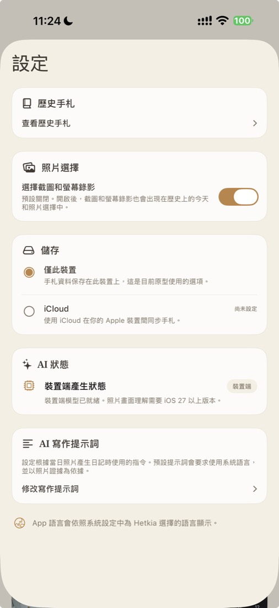

# 时光 / Hetkia

[English](README.md) | 简体中文

本项目采用 [MIT License](LICENSE)。

时光（Hetkia）是一款专注于“历史上的今天”的 iOS 照片回忆应用。首页按设备本地日期展示历年同月同日的照片组合。浏览时只读取 PhotoKit 并按需显示系统图像；只有用户生成日记、编辑并保存文字或发布留言时，才会把日记、照片关联和 JPEG 预览保存到本机。

## 功能

- 首次启动说明并申请完整照片图库权限；授权后扫描今天及历年同日照片，显示进度并自动进入首页。
- 首页只展示“历史上的今天”。照片铺满卡片，日期以白色文字叠在图片上。所有符合条件的照片都会显示，使用动态高度的 1/3 网格拼贴，并针对偶数张等数量避免留空。
- 详情页支持查看照片、放大翻页、地点地图、分享图片、编辑日记、设备端 AI 草稿和留言。日记正文与留言分开保存；AI 草稿卡片显示在留言板之前，应用草稿时若已有正文会先确认替换。仅查看不创建已保存日记或 JPEG 预览。
- 设置中的“历史手札”只读取本机已保存记录，按年月分组、两列展示；卡片图片铺满，日期和照片数以白字叠加。
- 桌面大尺寸 Widget 用同日记录首图生成满版拼贴，最多显示九篇，以 1/3 网格拼贴并优先选择带 GPS 坐标的照片；两篇时使用一张满版背景图和一张小图叠放。标题与品牌名浮在图片上。StandBy/小尺寸 Widget 保持纯图片拼贴。单张图片可深链到对应日记。
- 个人留言可编辑或删除；删除最后一条留言时，如果日记没有正文或 AI 草稿，应用会连同空日记及其关联照片预览一起删除。
- 设置中的 AI 提示词可查看和自定义；默认提示词要求依据照片与元数据写 2–5 句、使用当前系统语言且不包含具体日期。提示词最多 1,500 个用户可见字符，超出时保存会提示并被阻止。
- 照片、Live Photo 和视频可参与展示。截图和荧幕录影默认排除，可在设置中开启；开启后普通拍摄媒体优先。隐藏照片不显示，“最近删除”不在 PhotoKit 常规图库查询中。
- 支持简体中文、繁体中文、英语、西班牙语和泰语。

照片上的文字固定使用白色并加轻微暗色渐层保证对比度。WidgetKit 会按显示情境调整小组件的渲染，但不会自动按每张照片的明暗挑选文字颜色。日记详情和分享图片共用 1/3 网格拼贴布局；详情卡片高度随拼图变化，分享图保留日期时间。

## 平台与 AI

- 仅支持 iPhone 和 iPad，最低部署版本为 **iOS/iPadOS 18**；不支持 macOS 或 Mac Catalyst。
- 照片读取、系统缩略图、日记本地保存、地图、分享和 WidgetKit 等非 AI 功能可用于 iOS 18。
- Apple Foundation Models 日记文字生成需要 iOS 26 或更新版本、符合条件的设备以及已准备好的模型；项目会在用户点击生成时检查系统版本和模型状态。照片理解输入另要求 iOS 27 或更新版本。

后台刷新是系统调度的最佳努力任务，不保证恰好在午夜执行；应用前台刷新会重新查询 PhotoKit。

首页优先显示当天的本地照片索引缓存；缓存有效时，常规打开只查询今年今天的照片。下拉首页会强制重新扫描所有年份；首次使用或新一天尚无缓存时也会全量扫描。

热启动时，首页会保留已显示的缓存卡片，同时查询今年的照片；只有日期或照片标识发生变化时才发布新结果，避免内容未变时整页重新绘制。进程内扫描协调器会合并相同日期、时区、筛选设置和扫描范围的并发请求；进行中的完整扫描可满足较窄的当年查询，较窄查询不会代替用户要求的完整扫描。结果按生成序号提交，过期日期或较旧批次不会覆盖较新的索引。进度条只在首次全量扫描和用户主动下拉全量刷新时显示。

全量扫描仍会按日期查询 PhotoKit 中从 1900 年至今的历年媒体，即使本地已有日记也会重新检查照片；已保存日记不代表该年没有新增照片，且日记完整照片集合与首页优先展示集合用途不同。日记持久化任务保持原有触发和写入语义，不会因首页缓存命中而跳过用户操作所需的照片关联或 JPEG 预览生成。

主 App 与 Widget Extension 是独立进程。主 App 通过 App Group 写入轻量的小组件索引，小组件先用资源标识恢复照片；快照失效或照片不可用时，小组件回退到自己的 PhotoKit 查询。主 App 的扫描协调器不跨进程共享，避免让小组件与主 App 并发写入 SwiftData。

## 界面截图

| 首页无照片状态 | 日记详情 |
| --- | --- |
|  |  |

| 桌面小组件 | 分享手札 |
| --- | --- |
|  |  |

| 历史手札 | 设置 |
| --- | --- |
|  |  |

小组件拼贴样式和详情操作等其他参考图见 [`screenshot/`](screenshot/)。

## 构建

```sh
xcodebuild -project Hetkia.xcodeproj -scheme Hetkia -configuration Debug -destination 'generic/platform=iOS Simulator' CODE_SIGNING_ALLOWED=NO build
```

完整产品行为见[产品需求](docs/PRODUCT_REQUIREMENTS.md)，实现结构和验证记录见[开发说明](docs/DEVELOPMENT.md)。

## 目录

```text
Hetkia-Starter/
├── Hetkia.xcodeproj/            # App 与 WidgetKit extension targets
├── Hetkia/                      # SwiftUI App、引导、详情、PhotoKit、设置与本地化
├── HetkiaWidget/                # 历史上的今天 WidgetKit
├── Design/                      # 设计源稿
├── screenshot/                  # 按内容命名并压缩的界面参考截图
└── docs/                        # 产品需求与开发说明
```

产品需求和开发说明记录完整行为与实现细节；界面截图可在 `screenshot/` 中按首页、详情、设置、历史手札、小组件和分享图查看。
